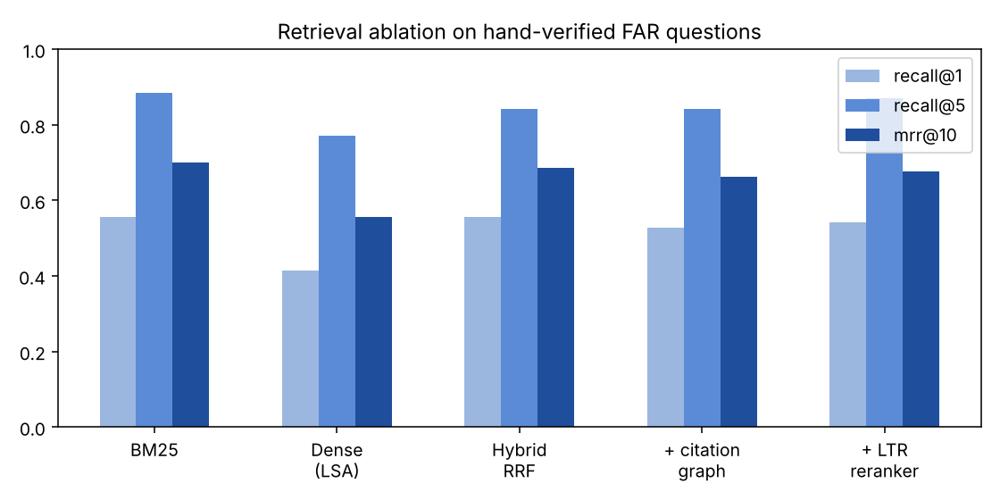

# Federal Acquisition Assistant: Agentic Graph-RAG over the FAR, with an evaluation harness

> **Mission:** Contracting officers and acquisition analysts lose hours searching a 2,000-page regulation and
> cross-referencing thresholds. This assistant answers Federal Acquisition Regulation (FAR) questions with a
> citation behind every claim, builds a compliance checklist for a planned acquisition, and answers
> spending questions in plain English. It runs fully **offline** (air-gap friendly) and is **measured**, not demoed.



## Why this is different from a typical RAG demo

| Typical RAG demo | This project |
|---|---|
| Toy PDF, a few pages | The **entire official FAR** (GSA's GitHub edition, 3,868 regulatory units, 939k words) parsed into sections, chunks and a **6,215-edge citation graph** |
| "Looks right to me" | **Golden set of 70 hand-written questions** with gold sections, *each auto-verified against the regulation text*, plus out-of-scope questions, a held-out synthetic dev set, and a full ablation |
| Vector search only | BM25 + dense + Reciprocal Rank Fusion + citation-graph expansion (hub-corrected personalized PageRank) + a **LightGBM LambdaRank reranker trained with weak supervision** |
| LLM can say anything | **Citation guardrail** (every `[FAR x.y]` must exist *and* be in the retrieved context, otherwise the answer is replaced) + a **calibrated abstention classifier** |
| Hard-coded facts | The compliance agent **parses thresholds from the live FAR text at start-up** ($15,000 micro-purchase, $350,000 SAT, $2.5M certified cost or pricing data, J&A tiers). When the FAR changes, re-ingest; no code change |
| Needs an API key | Works with **zero LLM calls** (extractive generator). Plug in Anthropic, OpenAI or a local Ollama/vLLM model for fluent answers; the same guardrails apply |

## Architecture

```
                 ┌──────────────── Router (regulation | compliance | spending) ────────────────┐
question ──────► │                                                                               │
                 ▼                               ▼                                ▼
       RegulationAgent                  ComplianceAgent                    SpendingAgent
  BM25 ─┐                        thresholds parsed from FAR           NL → SQL (USAspending schema)
  Dense ┼─ RRF ─ citation graph  2.101 / 6.304 / 13.500 /             SQLite authorizer: SELECT-only,
  (LSA) ┘   (PPR, hub-corrected) 15.403-4 / 17.204 → checklist        whitelisted table
        └─ LambdaRank reranker → grounded generator → citation guardrail → abstention
```

## Results (`results/scorecard.md`, reproducible with one command)

**Retrieval** on the hand-verified golden set (section level):

| Mode | Recall@1 | Recall@5 | Recall@10 | MRR@10 |
|---|---|---|---|---|
| BM25 | 55.7% | 88.6% | 91.4% | 0.701 |
| Dense (LSA, offline) | 41.4% | 77.1% | 84.3% | 0.556 |
| Hybrid RRF | 55.7% | 84.3% | 91.4% | 0.686 |
| Hybrid + citation graph | 52.9% | 84.3% | 91.4% | 0.664 |
| Hybrid + graph + LTR reranker | 54.3% | 87.1% | 91.4% | 0.677 |

On a **held-out synthetic dev set** (400 questions on sections never used for training) the learned reranker
lifts Recall@1 from **56.0% (BM25) to 64.5%** and MRR from 0.649 to 0.716.

**Answers** (offline extractive generator, zero LLM calls): **100% citation validity**, 94% of answers cited,
**80% key-fact recall**, 80% of out-of-scope questions refused, about 6% false refusals, about 130 ms end to end.

**Agents:** router accuracy **100%** (92 requests) · NL→SQL execution accuracy **100%** (16 questions) ·
write statements blocked by the SQLite authorizer.

### What I learned (and would say in an interview)
* **BM25 is a brutal baseline on regulatory text.** The FAR repeats exact terms of art ("simplified acquisition
  threshold"), so lexical retrieval is hard to beat. The offline LSA "dense" model *hurts* when fused naively.
  A neural embedder (the `STEmbedder` drop-in, e.g. bge-small) is the first upgrade to make where model downloads are allowed.
* **Weak supervision transfers partially.** The reranker clearly wins on synthetic dev questions but only ties
  BM25 on human phrasing. The fix is a few hundred real analyst queries with click/accept labels, which is exactly
  what a production deployment collects.
* **Graph expansion needs a hub correction.** Raw personalized PageRank pulls `2.101 Definitions` (cited by nearly
  every section) into every result list. A unit test caught this, and the fix divides by global PageRank (relative lift).
  Even so, citation expansion is roughly neutral for single-section questions. Its value is surfacing the *cited*
  rules for multi-hop questions, which this golden set under-represents.
* **Definitions deserve their own chunks.** Splitting the 100k-word `2.101` into one chunk per defined term was the
  single largest answer-quality gain.

## Quick start

```bash
pip install -r requirements.txt
bash scripts/download_data.sh          # official FAR HTML from github.com/GSA/GSA-Acquisition-FAR
python scripts/run_pipeline.py         # parse → index → train reranker → full evaluation (~5 min, CPU)
streamlit run app.py                   # chat UI + scorecard tab
pytest -q                              # 10 unit tests (toy corpus, runs in ~1 s)
# Optional: export ANTHROPIC_API_KEY=... (or OPENAI_BASE_URL=http://localhost:11434/v1 for Ollama)
```

Example compliance request: *"We plan to award a $3.2 million sole-source software maintenance services contract for
7 years"* returns: FAR Part 15 procedures · small-business rule of two (19.502-2) · 15-day notice / 30-day response
(5.203) · written J&A (6.303) approved by the **competition advocate** (6.304, $900K–$20M tier) · **certified cost or
pricing data** required above $2.5M (15.403-4) · **7 years exceeds the 5-year services limit** (17.204(e)).

## Repo map
```
src/farrag/ingest.py      FAR HTML → sections, definition-aware chunks, citation graph
src/farrag/retrieval.py   BM25, LSA/ST embeddings, RRF, hub-corrected PPR, LambdaRank reranker, weak supervision
src/farrag/generate.py    extractive + LLM generators, citation guardrail, calibrated abstention
src/farrag/agents.py      router, ComplianceAgent (thresholds from text), SpendingAgent (guarded NL→SQL)
src/farrag/evaluate.py    Recall@k / MRR / nDCG, key-fact recall, citation validity, abstention, router, NL→SQL
eval/golden_qa.jsonl      70 hand-written + 5 out-of-scope questions (gold sections verified against FAR text)
eval/spending_qa.jsonl    16 NL questions with gold SQL
```

## Limitations and responsible use
* Decision support, **not legal advice**. Agency supplements (DFARS, GSAM, etc.), class deviations and the ongoing
  FAR overhaul are not included. The corpus is the GSA edition as of its 2026-03-30 commit.
* Spending answers run on a **synthetic sample in the USAspending.gov schema**. `src/farrag/spending_data.py`
  documents the bulk-download API call and the column mapping for real data.
* The extractive generator is faithful but terse and sometimes includes neighboring sentences. An LLM backend gives
  fluent prose, and the citation guardrail still applies.
* The golden set is small (70). Treat differences of a few points as noise.
